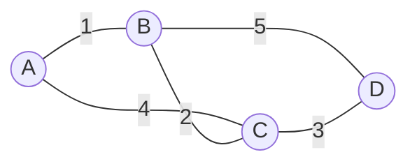

# MST
A Minimum Spanning Tree (MST) is a subset of the edges of a connected, weighted graph that connects all the vertices together with the minimum possible total edge weight. 

It is the cheapest or minimum cost subgraph in a given graph that connects all the nodes in the graph.

one possible MST is 

MST is useful when we want to connect all locations or nodes at the lowest total cost.

!!! info "MST vs Shortest Path"
    MST is not the same as shortest path.
    - Shortest path: minimize the cost from one source to a destination.
    - MST: minimize the total cost of connecting all vertices.