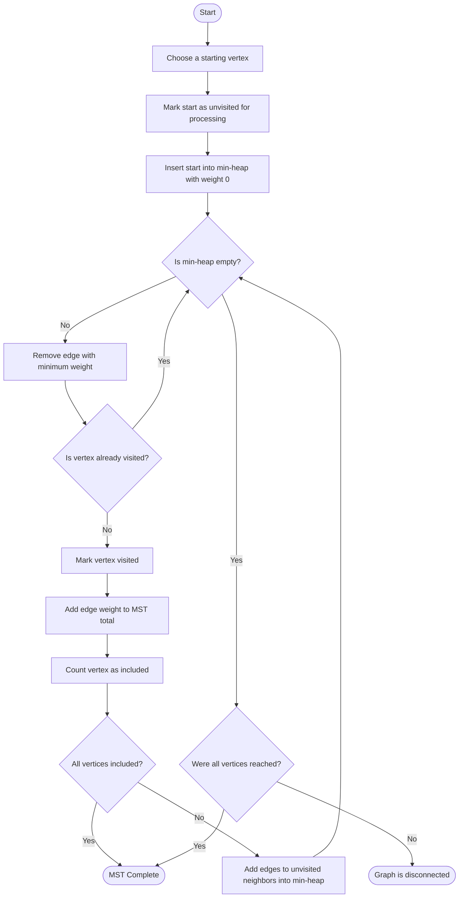

# Prim's MST




## Intuition
Prim’s algorithm builds the MST incrementally, starting with a single vertex and expanding the tree by adding the cheapest possible edge from the tree to a vertex not yet in the tree. It maintains a growing set of vertices that are part of the MST and continuously adds the smallest weight edge that connects a vertex in the MST to a vertex outside the MST.

## Steps
1. Choose a starting vertex.
2. Add its outgoing edges to a min-heap.
3. Pick the smallest edge that reaches an unvisited vertex.
4. Add that vertex to the MST.
5. Add its outgoing edges.
6. Continue until all vertices are included.


## Code

Java implementation of Prim using `PriorityQueue`

```java

import java.util.*;

class Solution {
    public int prim(int n, List<List<int[]>> graph) {
        // Each adjacency entry: [neighbor, weight]
        boolean[] visited = new boolean[n];

        // [weight, node]
        PriorityQueue<int[]> pq =
            new PriorityQueue<>(Comparator.comparingInt(a -> a[0]));

        pq.offer(new int[]{0, 0});

        int totalWeight = 0;
        int visitedCount = 0;

        while (!pq.isEmpty()) {
            int[] current = pq.poll();
            int weight = current[0];
            int node = current[1];

            if (visited[node]) {
                continue;
            }

            visited[node] = true;
            totalWeight += weight;
            visitedCount++;

            for (int[] edge : graph.get(node)) {
                int next = edge[0];
                int nextWeight = edge[1];

                if (!visited[next]) {
                    pq.offer(new int[]{nextWeight, next});
                }
            }
        }

        return visitedCount == n ? totalWeight : -1;
    }
}
```