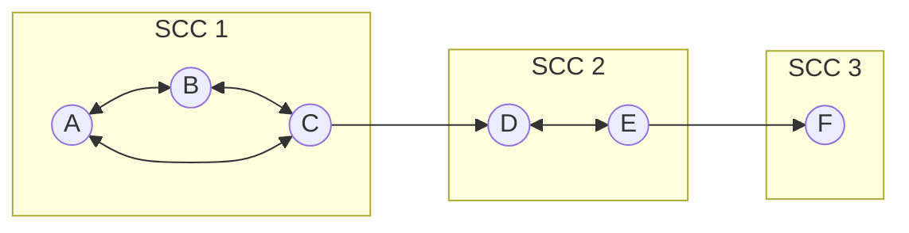
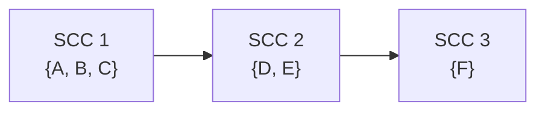

# Strongly Connected Component

Strongly Connected Components (SCCs) are subsets of vertices in a directed graph where each vertex in the subset is reachable from every other vertex in the same subset. In other words, if there is a path from each vertex in the subset to all other vertices within the subset, then those vertices form a strongly connected component. 




!!! info "Strongly Connected Graph"
    A strongly connected graph is a directed graph where every node is reachable from every other node. In formal terms, for any pair of vertices u and v in the graph, there exists a path from u to v and also a path from v to u.

    ```mermaid
    flowchart LR
        A((A)) --> B((B))
        B --> C((C))
        C --> D((D))
        D --> A
        A --> C
        C --> A
    ```


Strongly Connected Components (SCCs) represent a partitioning (division) of a directed graph into maximal subgraphs where each node within the subgraph can reach every other node in that subgraph. 
- This division creates groups of nodes (subgraphs) that are mutually reachable from one another, either directly or through intermediate nodes present in the same subgraph.
- Each SCC forms a strongly connected graph on its own, where every node can reach every other node within that component.

SCCs help identify groups of nodes that are mutually reachable.

Common uses:
- Finding cycles and cyclic groups in directed graphs
- Dependency analysis
- Detecting mutually reachable states
- Condensing a directed graph into a DAG
- Graph-based scheduling and reachability problems

If every SCC is compressed into a single “super-node,” the resulting graph is always a DAG (Directed Acyclic Graph).

