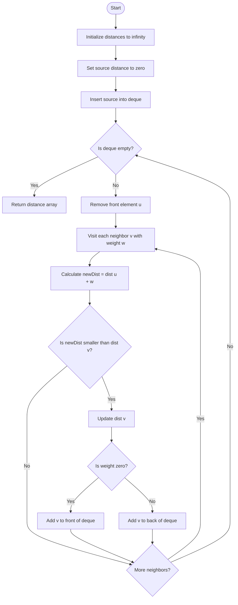

# 0-1-BFS



0-1 BFS is a shortest-path algorithm used when every edge has a weight of either 0 or 1. It is an optimized version of BFS that uses a Deque (Double-Ended Queue) instead of a normal queue.

The main idea:
- If an edge has weight 0, add the next vertex to the front of the deque.
- If an edge has weight 1, add the next vertex to the back of the deque.

This ensures that vertices with smaller tentative distances are processed first.


> Normal BFS works when all edges have equal weight (typically weight 1). Dijkstra works with arbitrary nonnegative edge weights, but it uses a priority queue.
> 
> But what if all edges have only weights 0 and 1? We can use 0-1 BFS, which is simpler and often faster than Dijkstra


## Implementation 

```java
import java.util.*;

class Solution {

    public int[] zeroOneBFS(
            int n,
            List<List<int[]>> graph,
            int source) {

        final int INF = Integer.MAX_VALUE;

        int[] dist = new int[n];
        Arrays.fill(dist, INF);

        Deque<int[]> deque = new ArrayDeque<>();

        dist[source] = 0;
        deque.addFirst(new int[]{source, 0});

        while (!deque.isEmpty()) {

            int[] current = deque.pollFirst();

            int u = current[0];
            int currentDist = current[1];

            // Ignore outdated deque entries
            if (currentDist != dist[u]) {
                continue;
            }

            for (int[] edge : graph.get(u)) {

                int v = edge[0];
                int weight = edge[1];

                int newDist = dist[u] + weight;

                if (newDist < dist[v]) {

                    dist[v] = newDist;

                    if (weight == 0) {
                        deque.addFirst(new int[]{v, newDist});
                    } else {
                        deque.addLast(new int[]{v, newDist});
                    }
                }
            }
        }

        return dist;
    }
}
```

