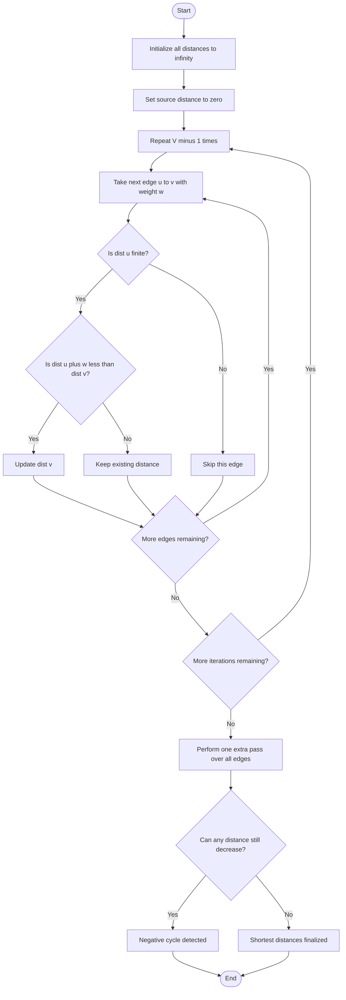

# Bellman-Ford Algorithm




Bellman-Ford is a single-source shortest path algorithm used to find the shortest distance from one source vertex to every other vertex in a weighted, directed or undirected graph.

!!! important "Highlight" 
    Its biggest advantage over Dijkstra's algorithm is that it supports negative edge weights (Negative edges can make Dijkstra's greedy approach incorrect.)

It can also detect negative-weight cycles that are reachable from the source.


## Core idea
The most important operation in Bellman-Ford is called relaxation. Relaxation is the process of updating the distance estimate of a node by considering the distance from the source node to the current node, plus the weight of the edge connecting the current node to the next node. If this combined distance is shorter than the current distance estimate for the next node, the distance estimate is updated.


```java
if (dist[u] != INF && dist[u] + weight < dist[v]) {
    dist[v] = dist[u] + weight;
}
```

Bellman-Ford repeats this process for all edges.


!!! tip "Key insight"
    In a graph with V vertices, a shortest path (assuming no reachable negative cycle) can be represented using at most V - 1 edges.

    A shortest path does not need to visit the same vertex twice. If it did, it would contain a cycle that could be removed without increasing the cost when there is no negative cycle.

    Therefore:
      - After 1 iteration, shortest paths using up to 1 edge are discovered.
      - After 2 iterations, shortest paths using up to 2 edges are discovered.
      - After V - 1 iterations, all shortest paths are discovered.
      We call each complete pass over all edges an iteration.

## Implementation

```java
class Solution {
    public int[] bellmanFord(int n, List<Edge> edges, int source) {

        int INF = Integer.MAX_VALUE;
        int[] dist = new int[n];

        Arrays.fill(dist, INF);
        dist[source] = 0;

        // Step 1: Relax all edges V - 1 times
        for (int i = 0; i < n - 1; i++) {

            boolean updated = false;

            for (Edge edge : edges) {
                int u = edge.u;
                int v = edge.v;
                int w = edge.weight;

                if (dist[u] != INF &&
                    dist[u] + w < dist[v]) {

                    dist[v] = dist[u] + w;
                    updated = true;
                }
            }

            // Optimization: no changes means we're done
            if (!updated) {
                break;
            }
        }

        // Step 2: Check for a reachable negative cycle
        for (Edge edge : edges) {
            int u = edge.u;
            int v = edge.v;
            int w = edge.weight;

            if (dist[u] != INF &&
                dist[u] + w < dist[v]) {

                throw new IllegalStateException(
                    "Negative cycle detected"
                );
            }
        }

        return dist;
    }
}
```


## Negative cycle detection

Bellman-Ford detects only negative cycles reachable from the chosen source. After V - 1 iterations, run through all edges one more time.

If any distance can still be reduced:

```
dist[u] + w < dist[v]
```

then a negative-weight cycle is reachable from the source. 


## Time & Space Complexity

### Time Complexity

The time complexity of the Bellman-Ford algorithm is $\text{O}(V * E)$ , where $V$ is the number of vertices and $E$ is the number of edges in the graph. This is because the algorithm works by iterating through all the edges in the graph $V-1$ times, where $V$ is the number of vertices. In each iteration, the algorithm updates the distance of each vertex from the source vertex, based on the weights of all the edges $E$. This process continues until the distances cannot be further improved, or until a negative-weight cycle is detected.

### Space Complexity

The space complexity of the Bellman-Ford algorithm is $\text{O}(V)$, where $V$ is the number of vertices in the graph. This is because the algorithm requires the use of a distance array, which stores the estimates of current distance of each vertex from the source vertex.
