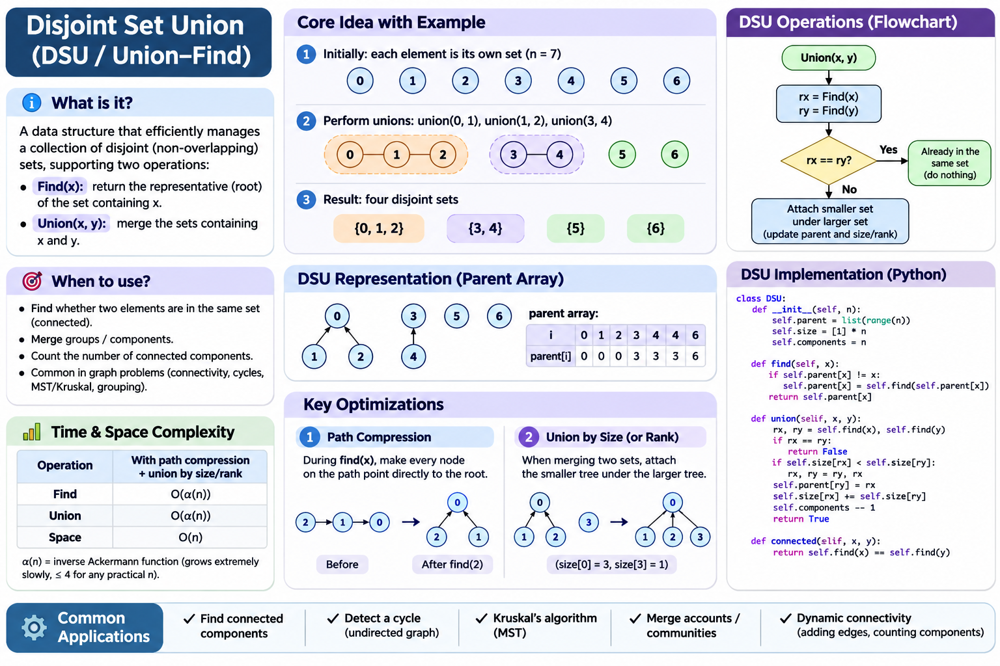
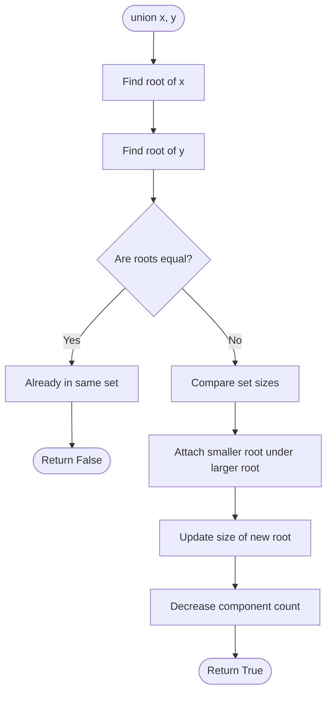

# Disjoint Set Union


Disjoint Set Union (DSU), also known as **Union–Find**, is a data structure used to efficiently maintain a collection of **disjoint (non-overlapping) sets**. It is especially useful in graph problems where we need to determine whether two nodes belong to the same connected component, merge components, detect cycles, or count connected groups.

DSU is a strong choice when the problem involves groups that merge.

Look for phrases such as:
- “Are these nodes connected?”
- “Merge these two groups.”
- “Find the number of connected components.”
- “Add an edge and determine whether it creates a cycle.”
- “Group equivalent elements.”
- “Connect components with the minimum total cost.”

??? info "What Is Disjoint Set Union?" 
    Imagine a group of people. Initially, every person belongs to their own group.
    
    When two people become friends, their groups are merged. Later, we may need to answer:
    
    - Are these two people in the same group?
    - How many groups remain?
    - If we connect these two people, will we merge two different groups?
    
    DSU supports these operations efficiently.

## Core Operations
| Operation | Meaning |
|---|---|
| `find(x)` | Returns the representative (root) of the set containing `x`. The representative is simply the root chosen to represent that set. It does not have any special meaning beyond identifying the group. |
| `union(x, y)` | Merges the sets containing `x` and `y` |

## How DSU Represents Sets

DSU commonly represents each set as a tree. Each node stores a parent pointer. A root is a node whose parent is itself.

### find() Operation
`find(x)` returns the root of the tree containing x.

### union() Operation
`union(x, y)` merges the sets containing x and y.

The process is:
1. Find the root of x.
2. Find the root of y.
3. If the roots are equal, the elements are already in the same set.
4. Otherwise, make one root a child of the other.

The return value can indicate whether a merge actually happened.
- True: two different sets were merged.
- False: both elements were already in the same set.
This is useful for counting components and detecting cycles.

## Optimizing DSU
A basic DSU can become slow if its trees become tall. Two optimizations make it extremely efficient.

### Path Compression
During `find(x)`, path compression makes every visited node point directly to the root.

```python
def find(x):
    if parent[x] != x:
        parent[x] = find(parent[x])
    return parent[x]
```

### Union by Size

When merging two sets, attach the smaller tree under the larger tree.

```python
def union(x, y):
    root_x = find(x)
    root_y = find(y)

    if root_x == root_y:
        return False

    if size[root_x] < size[root_y]:
        root_x, root_y = root_y, root_x

    parent[root_y] = root_x
    size[root_x] += size[root_y]

    return True
```


### Union by Rank
Another option is union by rank, which attaches the tree with lower rank under the tree with higher rank.

Rank is an estimate of tree height, not necessarily the number of nodes

## Flow



- pattern 1: Count Connected Components
- pattern 2: Detect a Cycle in an Undirected Graph
  - For each edge (u, v):
    - If find(u) == find(v), the endpoints are already connected.
    - Adding the edge creates a cycle.
    - Otherwise, merge their components.
- pattern 3: Kruskal’s Minimum Spanning Tree
- pattern 4: Merge Accounts or Groups
- pattern 5: DSU on a Grid
  - For a grid, map each cell (r, c) to a unique integer
- pattern 6: Offline Connectivity Queries