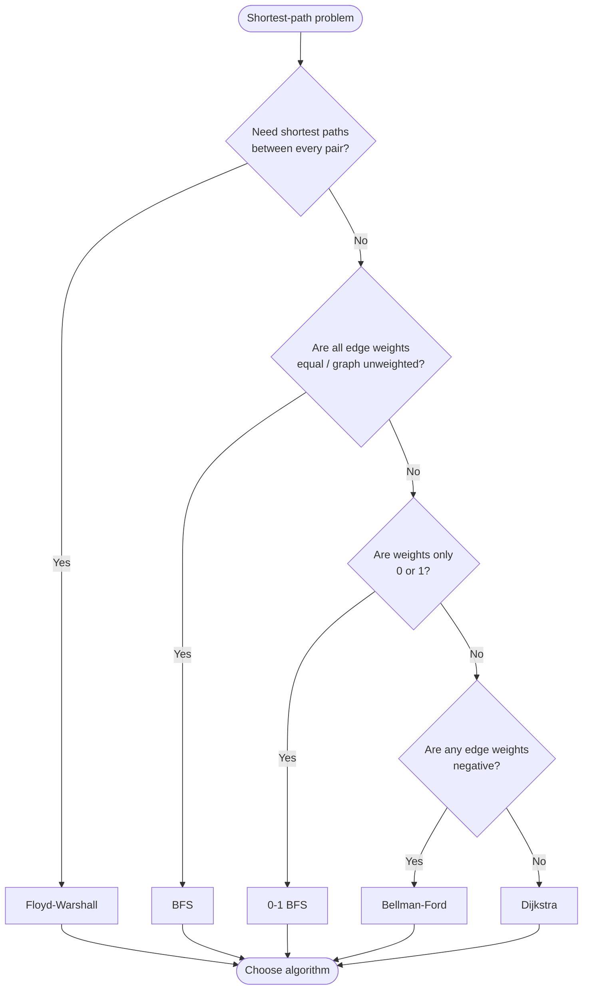

# Traversal algorithms

| Algorithm | Best for | Edge weights | Negative edges? | Single-source or all-pairs? | Main data structure / approach | Time complexity |
|---|---|---|---|---|---|---|
| **BFS** | Shortest path in an unweighted graph | Equal weight / unweighted | Not applicable | Single-source | Queue; explore level by level | `O(V + E)` |
| **0-1 BFS** | Shortest path when weights are only `0` or `1` | `0` and `1` | No | Single-source | Deque; `0`-weight edges to front, `1`-weight edges to back | `O(V + E)` |
| **Dijkstra** | Shortest path with non-negative weights | Non-negative | No | Single-source | Min-heap / priority queue; greedy relaxation | `O((V + E) log V)` with adjacency list + heap |
| **Bellman-Ford** | Shortest path when negative edges may exist; detect negative cycles | Positive, zero, or negative | Yes | Single-source | Relax all edges up to `V−1` times | `O(VE)` |
| **Floyd-Warshall** | Shortest paths between every pair of vertices | Positive, zero, or negative | Yes, if no negative cycle | All-pairs | Dynamic programming over intermediate vertices | `O(V³)` time, `O(V²)` space |