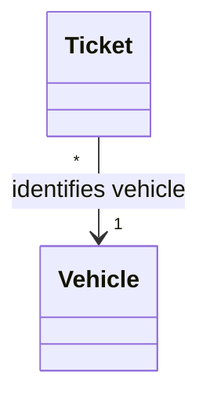
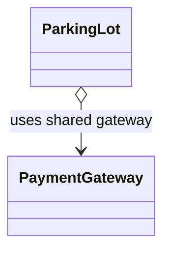
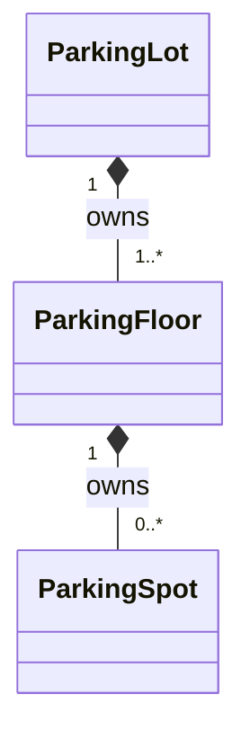
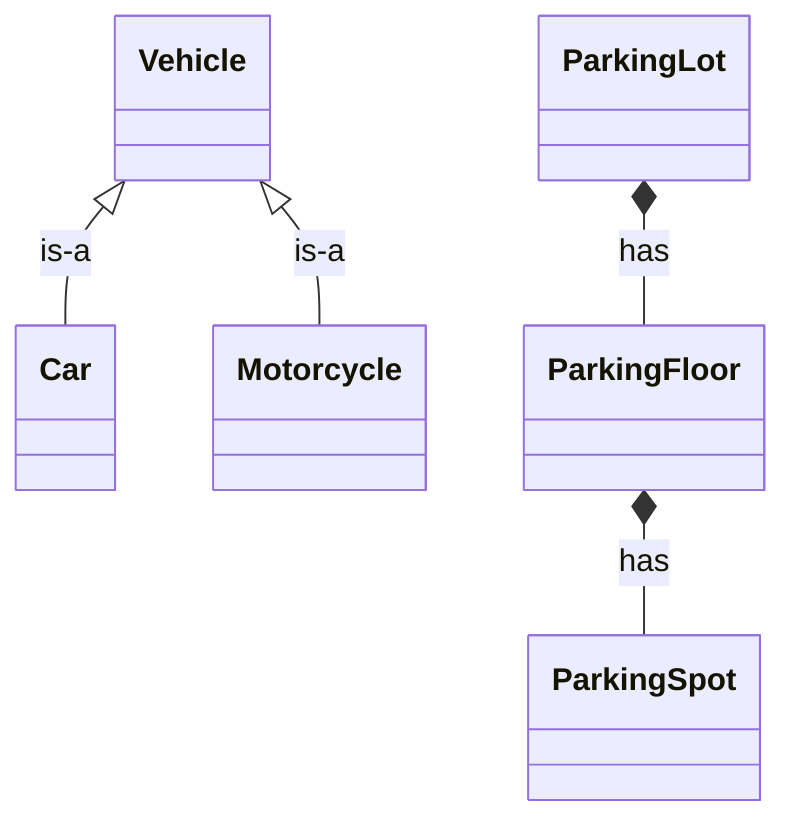
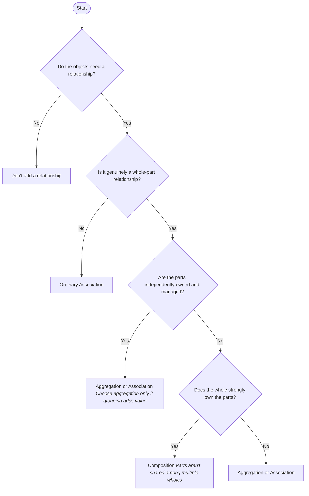

# Composition, Asociation & Aggregation

| Property | Association | Aggregation | Composition |
| :--- | :--- | :--- | :--- |
| **Meaning** | Objects are related | Whole groups independent parts | Whole strongly owns parts |
| **Ownership** | Not implied | Weak / shared or independent | Strong |
| **Part can exist independently?** | Usually yes; no lifecycle claim | Yes | Conceptually tied to the whole |
| **Part can be shared?** | Yes, if allowed | Commonly yes | Generally no simultaneous ownership by multiple wholes |
| **UML notation** | Plain line or arrow | Hollow diamond | Filled diamond |

## Association
Two objects have a relationship, but neither necessarily owns the other. It says that one object knows about, refers to, or interacts with another object.

## Aggregation

It is a more specific kind of association. It represents a whole-part relationship, but the parts can exist independently of the whole. One object groups or references other objects, but those objects can exist independently and may be shared. 

Use it when:
- The whole groups parts.
- The parts have an independent lifecycle.
- The parts may be shared or reassigned.
- The distinction from ordinary association adds useful meaning.

> UML aggregation has relatively weak, often ambiguous semantics. Many designs use an ordinary association instead.

## Composition 
Composition is a relationship where one object is made up of, or owns, other objects that help form it. So instead of making one giant class do everything, ==we build a larger object using smaller objects, each with its own responsibility==.

> The filled diamond `*--` indicates composition

composition does not mean an object must be deleted whenever its parent is deleted in every implementation. It communicates strong ownership in the domain model. Actual deletion and persistence behavior depend on the requirements

### Composition vs Inheritance
**Composition** means “has-a” or “is made of”, whereas **Inheritance** means “is-a”

Prefer composition over inheritance when combining functionality. Use inheritance when a genuine subtype relationship exists and the subtype can safely stand in for its parent

## How to choose ?

