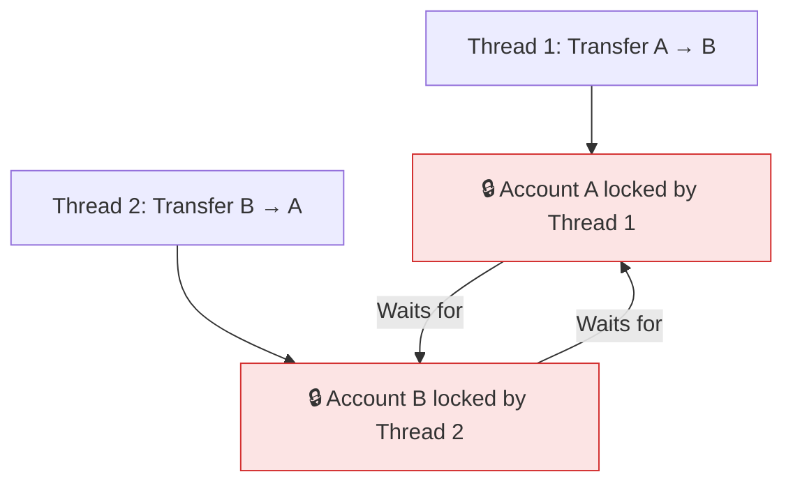
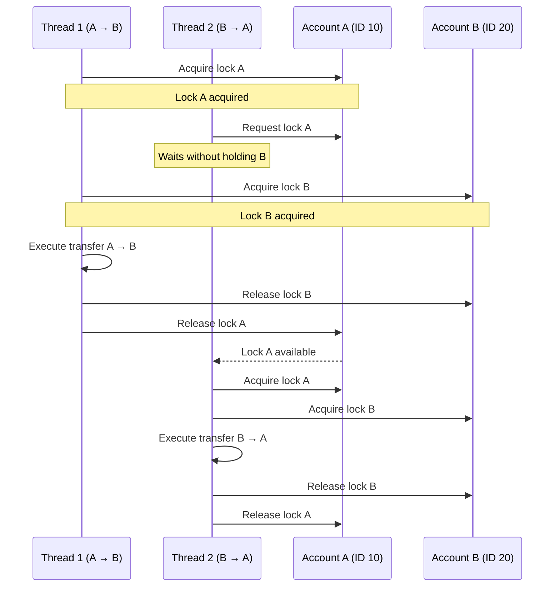

# Global Lock Ordering

> A lock is a mechanism that allows only one thread at a time to access a protected resource or critical section.

A deadlock occurs when two or more threads are permanently waiting for locks held by one another, so none of them can proceed.

Scenario, User A transfers $50 to B. At the exact same time, B transfers $20 back to A. For a transfer, we need to modify two accounts. We must lock both accounts to prevent another transaction from changing their balances midway through the transfer.
- Thread 1 locks Account A → then waits for Account B.
- Thread 2 locks Account B → then waits for Account A.
Both threads are waiting. Neither can proceed.

The Coffman conditions, all four must hold simultaneously for a deadlock.

| Condition | Meaning | Bank transfer example |
|---|---|---|
| 1. Mutual Exclusion | A resource can be held by only one thread at a time. | Only one thread can hold Account A's lock. |
| 2. Hold and Wait | A thread holds one resource while waiting for another. | Thread 1 holds A and waits for B. |
| 3. No Preemption | A lock cannot simply be forcibly taken away from its owner. | Thread 2 cannot forcibly take Account B's lock from Thread 1. |
| 4. Circular Wait | Threads form a circular chain of dependencies. | Thread 1 waits for B, while Thread 2 waits for A. |

**Global Lock Ordering** prevents deadlocks caused by circular wait by ensuring every thread acquires shared resources in the same predefined order, irrespective of the business operation it is performing. For example, always acquire locks in ascending order of their resource ID

