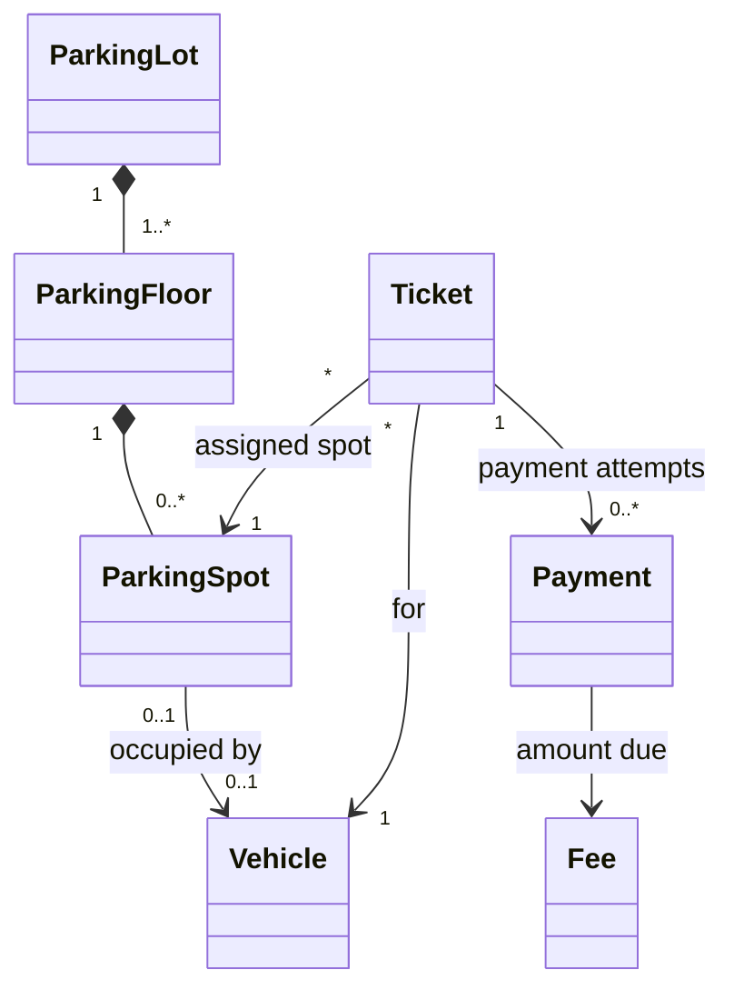
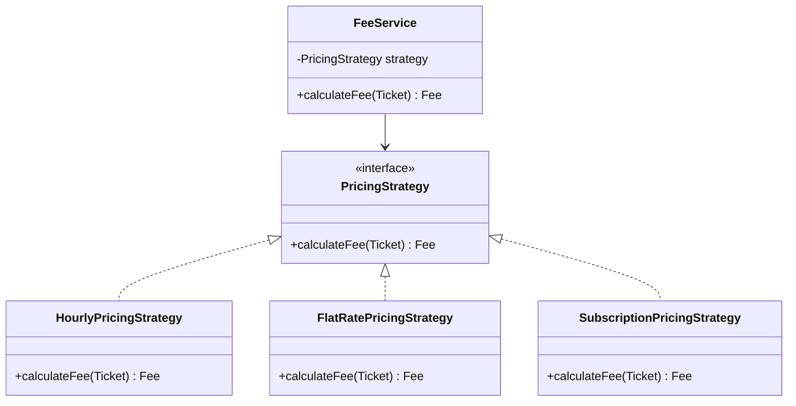
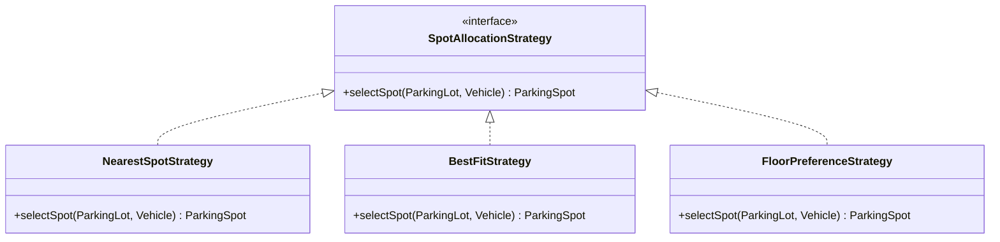
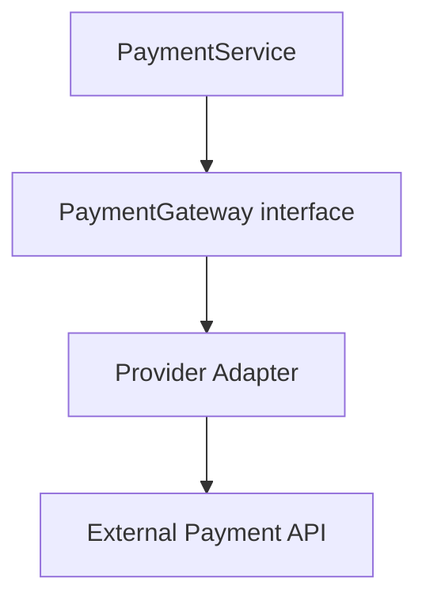

# Design a Parking Lot

Design a multi-floor parking lot. Vehicles enter through entry gates, receive tickets, park in compatible available spots, and exit through exit gates. On exit, the system calculates the parking fee, collects payment, and makes the spot available again.

The design should be extensible, testable, and safe when multiple gates operate concurrently.

### Core requirements — must implement
- [ ] Support motorcycles, cars, and trucks.
- [ ] Support multiple floors and different spot sizes.
- [ ] Find an available spot compatible with a vehicle.
- [ ] Assign a spot and issue a unique parking ticket.
- [ ] Prevent a vehicle from being parked twice.
- [ ] Track entry time and exit time.
- [ ] Calculate parking fees based on parking duration and vehicle type.
- [ ] Process payment before completing exit.
- [ ] Free the spot after successful checkout.
- [ ] Handle a full parking lot and invalid tickets.
- [ ] Provide availability by floor and spot type.

### Extended requirements — discuss if time permits
- [ ] Multiple entry and exit gates.
- [ ] Different spot-allocation strategies.
- [ ] Configurable hourly, flat-rate, or dynamic pricing.
- [ ] Electric-vehicle charging spots and accessible spots.
- [ ] Reservations and temporary spot holds.
- [ ] Different payment methods and payment failures.
- [ ] Display boards and notifications.


### Non-functional requirements
- [ ] Correctness: never assign one spot to two active tickets.
- [ ] Consistency: a vehicle, active ticket, and occupied spot must agree.
- [ ] Extensibility: new vehicle types and pricing policies should require minimal changes.
- [ ] Testability: business logic should be testable without a database, real clock, or payment provider.
- [ ] Concurrency safety: simultaneous entry requests must not claim the same spot.
- [ ] Maintainability: each class should have a clear responsibility.
- [ ] Performance: finding a spot and retrieving ticket state should avoid unnecessary full-lot scans where practical.

### Explicit assumptions
| Area | Assumption for our solution |
| :--- | :--- |
| **Spot compatibility** | A larger spot can accommodate a smaller vehicle |
| **Vehicle size** | Motorcycle < Car < Truck |
| **Parking** | One vehicle occupies one spot |
| **Ticket** | One active ticket per vehicle |
| **Pricing** | Hourly rate varies by vehicle type; each started hour is charged |
| **Time** | Entry and exit timestamps use an injectable Clock |
| **Payment** | Payment must succeed before checkout is finalized |
| **Reservation** | Not part of the initial implementation |
| **Persistence** | In-memory storage for the machine-coding version |
| **Concurrency** | Allocation and release must be atomic |


## Solution

### Entities 

They represent domain concepts and maintain their own valid state.

- ParkingLot
  - Owns or references the floors and provides a view of the parking facility. It can coordinate spot discovery through an allocation policy.
- ParkingFloor
  - Groups the spots on one floor and can report floor-level availability or find compatible spots.
  - A separate class is justified because floors group spots and may have their own policies or reporting.
- ParkingSpot
  - Owns its identifier, type and occupancy state. It enforces rules such as not assigning an already occupied spot and not releasing an empty one.
- Vehicle 
  - Holds vehicle identity, such as license plate, and its type.
  - Keep identity and vehicle facts here; don't make the vehicle responsible for finding spots or charging fees.
- Gate
  - Represents an entry or exit gate. It may carry an ID, gate type and operational status.
  - The gate can request a parking operation, but ParkingLotService owns the workflow.
- Ticket
  - Represents the driver's parking session and checkout reference: ticket ID, vehicle, spot, entry time, optional exit time and status.
  - The ticket is the authoritative record of that session in this design. It replaces the separate Parking entity.
- Fee
  - A value object representing an amount and currency. For example, INR 240.00.
  - A fee is a calculated monetary value, not a payment transaction.
- Payment
  - Records a payment attempt: ID, amount, status and provider transaction reference.
  - A ticket may have multiple payment attempts if the first attempt fails. Keep transaction history rather than overwriting every attempt into one record.




??? info "Composition"
    ParkingLot to ParkingFloor and ParkingFloor to ParkingSpot are composition relationships in this model: floors and spots belong to the facility structure.
    

### Services — application workflows

- ParkingLotService
  - main orchestrator for entry and exit. 
  - spot assignment
  - checkout orchestration
  - create and register a ticket
  - coordinate payment
- PaymentService
  - Payment processing and outcome handling
- FeeService
  - Fee calculation workflow

### Extension points
- PricingStrategy
- SpotAllocationStrategy
- PaymentGateway

> The central principle is that services coordinate, the entities protect domain state and strategies supply interchangeable policies.


??? info "SOLID principles applied"
    - Single Responsibility Principle (SRP)
      - A class should have one cohesive responsibility—more precisely, one primary reason to change.
        - ParkingSpot manages occupancy.
        - FeeService calculates fees.
        - PaymentService handles payment outcomes.
        - ParkingLotService coordinates the use case.
    - Open/Closed Principle (OCP)
      - The system should be open to new behavior but not require risky modifications to stable workflow code for every extension. OCP does not mean never modifying existing code. It means isolating likely variation behind appropriate extension points.
        - Adding weekend pricing should mean introducing a new pricing implementation or configuration, not repeatedly editing a large if/else block in checkout.
    - Liskov Substitution Principle (LSP)
      - Any implementation of an interface should honor its contract.
        - A PricingStrategy implementation must return a valid fee under the same agreed rules. 
        - A payment gateway implementation must not silently claim success when payment failed.
    - Interface Segregation Principle (ISP)
      - Keep interfaces focused on what a caller actually needs.
        - A payment gateway should expose payment-related operations it shouldn't also require methods for finding spots or calculating parking duration.
    - Dependency Inversion Principle (DIP)
      - High-level workflows should depend on abstractions rather than concrete infrastructure implementations.Dependency injection supplies the chosen implementation to the service, often through its constructor.
        - PaymentService depends on PaymentGateway, not directly on one provider's SDK. 
        - FeeService depends on PricingStrategy, not a hardcoded hourly calculator.

### Design Patterns

#### Pattern 1: Strategy — choose interchangeable behavior
Use **Strategy** when the same operation can be performed by multiple algorithms or policies.

**Pricing strategy** 



Without Strategy, the fee service can accumulate conditionals for hourly, weekend, subscription and promotional rules.

The strategy is resolved based on the applicable pricing policy, which could come from application configuration or a parking-lot-specific database configuration. ==A resolver or factory maps the policy to a PricingStrategy implementation, and FeeService uses that strategy through the common interface==. If pricing can vary by customer or time, the resolver incorporates those business rules. I would also define how policy changes affect active tickets, potentially recording a pricing-policy version when a session starts.


```java
interface PricingStrategy {
    double calculateFee(int hours);
}

class HourlyPricingStrategy implements PricingStrategy {
    private final double ratePerHour;
  
    @Override
    public double calculateFee(int hours) {
        return hours * ratePerHour;
    }
}

class FlatRatePricingStrategy implements PricingStrategy {
    private final double flatRate;

    @Override
    public double calculateFee(int hours) {
        return flatRate;
    }
}

enum PricingMode {
    HOURLY,
    FLAT_RATE
}

class PricingStrategyFactory {

    static PricingStrategy create(PricingMode mode) {
        switch (mode) {
            case HOURLY:
                return new HourlyPricingStrategy(50);

            case FLAT_RATE:
                return new FlatRatePricingStrategy(200);

            default:
                throw new IllegalArgumentException(
                    "Unsupported pricing mode: " + mode
                );
        }
    }
}

public class Main {
    public static void main(String[] args) {

        // Imagine this value came from configuration.
        PricingMode configuredMode = PricingMode.HOURLY;

        PricingStrategy strategy =
            PricingStrategyFactory.create(configuredMode);

        FeeService feeService = new FeeService(strategy);

        double fee = feeService.calculateFee(3);

        System.out.println("Parking fee: ₹" + fee);
    }
}
```
**Spot allocation strategy**



These strategies should share a clear contract: return a compatible, available candidate or indicate that none exists.

#### Pattern 2: Factory — centralize object selection and creation
A Factory is useful when creating an object involves a selection rule or construction complexity.

Introduce one when object creation has meaningful logic, validation or configuration-dependent selection.

#### Pattern 3: Dependency Injection — provide collaborators from outside

Dependency Injection (DI) is a technique, not the same thing as Factory or Strategy.

Benefits:
- Unit tests can provide a fake pricing strategy or payment gateway.
- The core workflow does not construct infrastructure-specific dependencies itself.
- Configuration determines which implementation is used.

Constructor injection is often the simplest option. Avoid service classes that locate global dependencies or construct concrete providers internally.


#### Pattern 4: Adapter — integrate an external payment provider
An external provider may expose APIs and data structures that don't match your application's payment contract. An Adapter translates that call into the provider-specific API and maps the provider's response into your own payment result.



#### Pattern 5: Observer — when other components need updates

A display board at every entrance must automatically update whenever a vehicle enters or exits. So a component needs to react to state changes without being called directly by every entry and exit workflow.

```java
interface AvailabilityObserver {
    void onAvailabilityChanged(
        String lotId,
        int availableSpots
    );
}


interface AvailabilityPublisher {
    void subscribe(AvailabilityObserver observer);
    void unsubscribe(AvailabilityObserver observer);
    void publishAvailability(
        String lotId,
        int availableSpots
    );
}
```

A DisplayBoard could implement AvailabilityObserver and update its displayed count when notified.


### Enums vs. polymorphism

| Concept | Description / When to Use | Details / Examples |
| :--- | :--- | :--- |
| **Enum-based modeling** | Good fit when types mainly represent categories and differences are small, stable rules. | Represent vehicle kinds with `VehicleType` (MOTORCYCLE, CAR, TRUCK) and spot kinds with `SpotType`. |
| **Polymorphism** | Use when behavior genuinely differs across types. | Use separate implementations for distinct behaviors. |

!!! tip "Decision table"
    
    | Situation | Prefer |
    | :--- | :--- |
    | A small set of stable categories | Enum |
    | Different labels or basic attributes | Enum plus configuration |
    | Multiple algorithms for the same operation | Strategy / polymorphism |
    | Many growing conditional branches for changing behavior | Consider polymorphism |
    | Different data and genuinely different lifecycle | Separate classes where justified |
    | A type hierarchy with no meaningful behavioral differences | Usually avoid inheritance |

For this parking lot:
- enum : VehicleType, SpotType, TicketStatus, PaymentStatus
- interface : PricingStrategy, SpotAllocationStrategy

!!! Info "Common UML"
    - Realization — implements an interface 
      - `HourlyPricingStrategy ..|> PricingStrategy`
    - Generalization — inheritance 
      - `SpecializedType --|> BaseType`


## Concurrency

### Idempotent request
An idempotent request can be repeated without consequence, each entry request should have a unique request ID or idempotency key. Store the request and its result so a retry can return the original ticket rather than allocate another spot.

```
Request ID: ENTRY-8291
Vehicle: CAR-101
Gate: GATE-A
```

### Atomic spot claiming

If multiple gates must coordinate through a shared, authoritative source of parking-spot state. Each gate can handle requests independently, but two gates must never successfully assign the same spot to two vehicles.


**Approach A: In-memory, single application instance**

The availability check and state change happen as one synchronized operation for that spot.

```java
ParkingSpot {
  public synchronized boolean tryOccupy(Vehicle vehicle) {
      if (status != SpotStatus.AVAILABLE) {
          return false;
      }
  
      if (!canFit(vehicle)) {
          return false;
      }
  
      this.currentVehicle = vehicle;
      this.status = SpotStatus.OCCUPIED;
      return true;
  }
}
```

**Approach B: Database-backed, multiple application instances**

If multiple application use a shared database do an atomic conditional update.

```sql
UPDATE parking_spot
SET status = 'OCCUPIED',
    vehicle_id = :vehicleId
WHERE spot_id = :spotId
  AND status = 'AVAILABLE';
```

For claiming one spot, a conditional update is often enough. You don't need to lock an entire parking floor or parking lot.

!!! tip "Pessimistic vs Optimistic Locking"
    Pessimistic locking assumes conflict is likely and locks a row while the transaction works with it. It can be useful for short, multi-row operations, but increases waiting and deadlock risk.
    
    Optimistic locking assumes conflicts are less common. A version check detects concurrent changes; the loser retries. It is useful when conflicts are infrequent, but repeated contention can lead to many retries.


The spot claim and ticket creation should generally be in one database transaction

```
BEGIN TRANSACTION

  Verify vehicle has no active ticket
  Claim a compatible spot atomically
  Create active ticket
  Store entry request result

COMMIT
```

If ticket creation fails, roll back the spot claim. If the active-ticket uniqueness constraint rejects the transaction, roll back the claim as well.
    

### Availability counters and display boards
After the transaction commits, publish an availability event. Display boards and other subscribers update their views.

The **transactional outbox pattern** is useful: ==write an event record in the same transaction as the state change, then publish it asynchronously==. This avoids the failure where the spot update commits but the process crashes before publishing its event.

## Verification

| Requirement | How it’s handled |
| :--- | :--- |
| Support motorcycles, cars, and trucks | VehicleType defines vehicle categories; Vehicle stores the type and license plate. |
| Multiple floors and different spot sizes | ParkingLot contains floors; ParkingFloor manages spots of different types and sizes. |
| Find a compatible available spot | SpotAllocationStrategy selects a candidate; ParkingSpot validates and claims it. |
| Assign a spot and issue a unique ticket | ParkingLotService claims the spot and creates a unique Ticket in one transaction. |
| Prevent duplicate parking | Check for an active ticket and enforce a database uniqueness constraint per vehicle. |
| Track entry and exit times | Ticket stores entryTime and finalized exitTime. |
| Calculate fees by duration and vehicle type | FeeService uses PricingStrategy and ticket duration to calculate the fee. |
| Process payment before exit | PaymentService processes payment; checkout completes only after confirmed success. |
| Free the spot after checkout | ParkingLotService closes the ticket and releases the spot transactionally. |
| Availability by floor and spot type | ParkingFloor and ParkingSpot provide counts; AvailabilityService can aggregate them. |
| Multiple entry and exit gates | Gate identifies each gate; all gates use the shared ParkingLotService. |
| Different spot-allocation strategies | SpotAllocationStrategy supports implementations such as nearest spot and best fit. |
| Configurable hourly, flat-rate, or dynamic pricing | PricingPolicy stores configuration; PricingStrategyResolver selects the applicable strategy. |
| EV charging and accessible spots | ParkingSpot stores features; SpotCompatibilityPolicy checks vehicle and eligibility requirements. |
| Reservations and temporary holds | ReservationService manages reservations and expiring holds, coordinating with spot availability. |
| Different payment methods and failures | PaymentService uses PaymentGateway adapters and tracks payment status, retries, and uncertain outcomes. |
| Display boards and notifications | Availability changes are published to observers or event consumers that update boards and send notifications. |