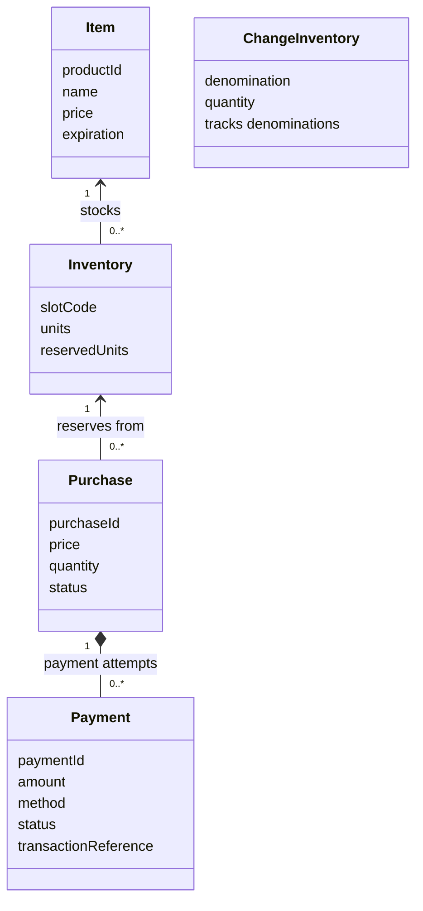
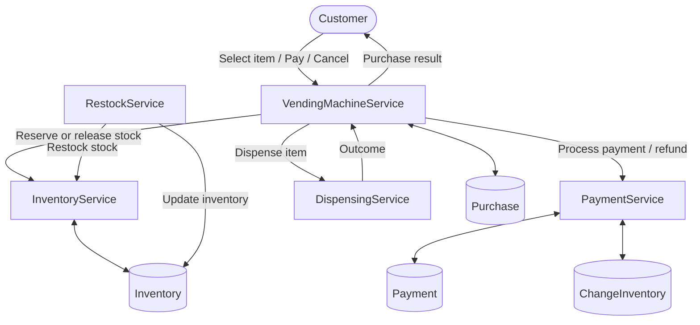
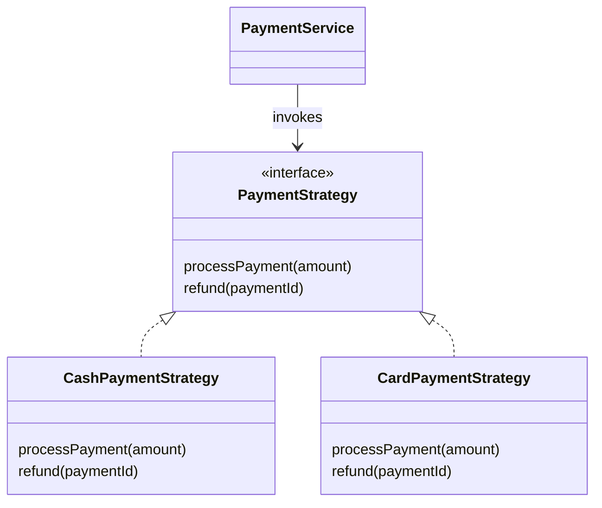
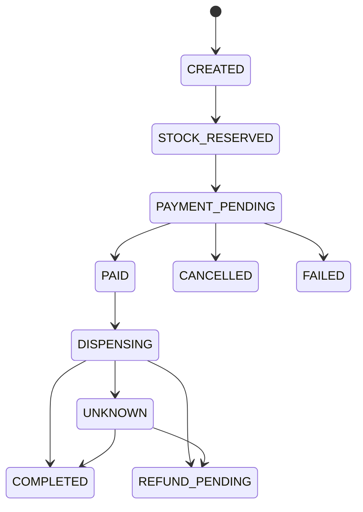
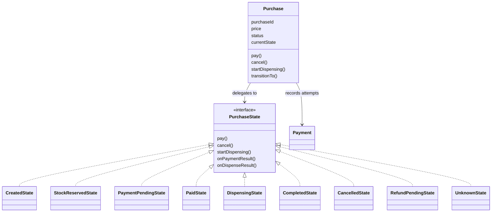
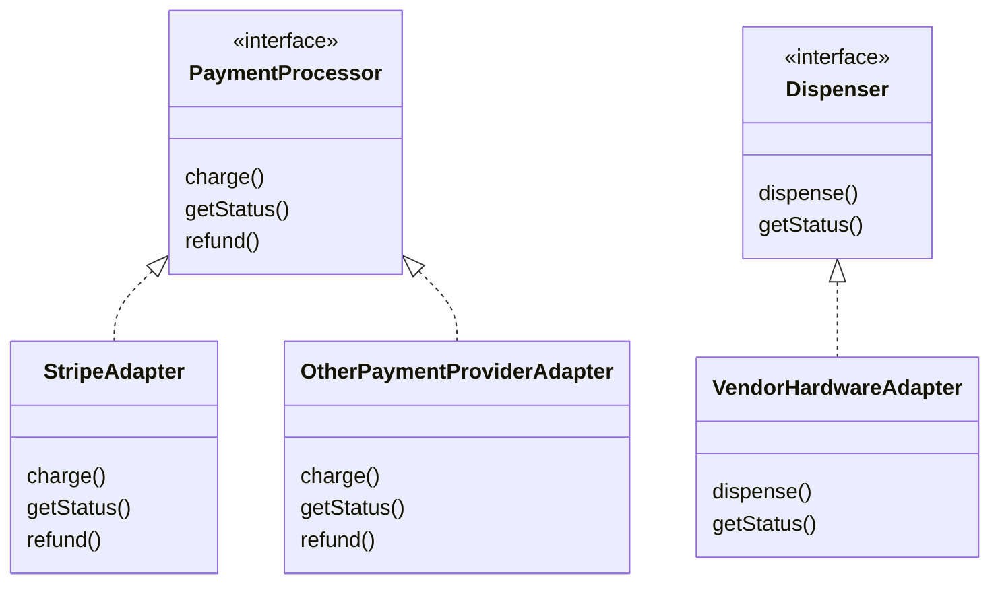
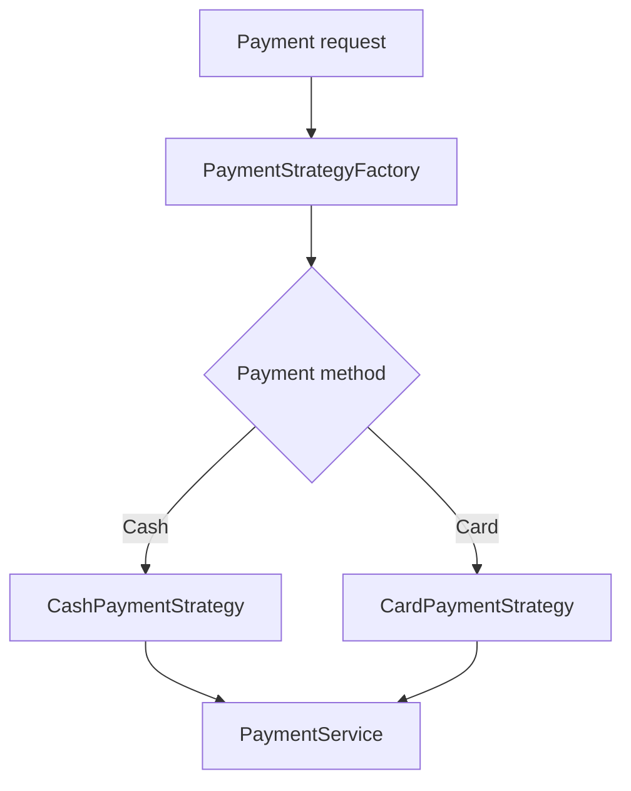
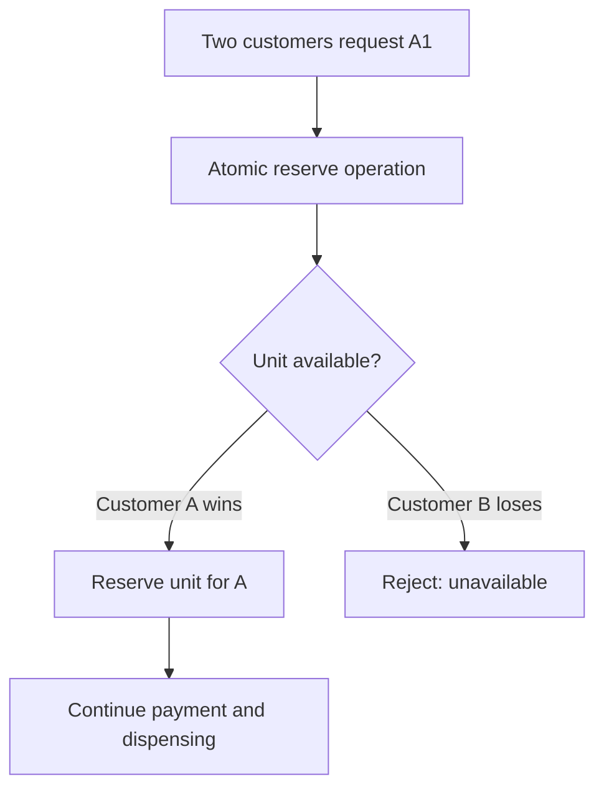

# Vending Machine

Design a vending machine that supports product selection, inventory management, payments, dispensing, change, and failure recovery.

### Core requirements — must implement

- [ ] Support multiple products with different prices and available quantities.
- [ ] Allow customers to select a product using a product code.
- [ ] Accept coins and notes of different denominations, as well as card payments.
- [ ] Validate product availability and ensure sufficient payment before dispensing.
- [ ] Dispense the selected product after successful payment.
- [ ] Return change when cash payment exceeds the product price.
- [ ] Update inventory after successful dispensing.
- [ ] Handle invalid selections, out-of-stock products, and insufficient funds.
- [ ] Allow customers to cancel a purchase and return inserted cash when permitted.
- [ ] Support concurrent transactions without overselling inventory or corrupting purchase state.
- [ ] Provide admin operations to restock products and collect money.

### Extended requirements — discuss if time permits

- [ ] Handle payment failures, timeouts, retries, and uncertain payment outcomes.
- [ ] Detect whether exact change is available and manage coin inventory.
- [ ] Handle dispensing failures after payment, including refunds and transaction recovery after crashes.
- [ ] Support product expiration and out-of-service slots.
- [ ] Generate sales, inventory, and revenue reports.

### Non-functional requirements

- [ ] Correctness: Never dispense more units than are available or reserved for valid purchases.
- [ ] Consistency: Keep purchase, payment, and inventory states consistent, including after failures.
- [ ] Concurrency safety: Ensure simultaneous transactions cannot claim the same final unit.
- [ ] Extensibility: Make it easy to add payment methods and pricing or product rules.
- [ ] Testability: Allow payment providers and dispensing hardware to be replaced by test doubles.
- [ ] Recoverability: Recover or reconcile interrupted purchases after hardware failures or crashes.

### Explicit assumptions

| Area | Assumption for our solution |
| :--- | :--- |
| **Product selection** | Customer selects one product using a code such as `A1`. |
| **Pricing** | Each product has a price; the price is captured when a purchase starts. |
| **Inventory** | Each slot stores a product and its available quantity. |
| **Purchase concurrency** | A unit is reserved before payment so two customers cannot purchase the same final unit. |
| **Cash payment** | Coins and notes are accepted; excess payment requires change. |
| **Card payment** | Payment is handled through a payment abstraction. |
| **Inventory deduction** | A reserved unit becomes sold after successful dispensing; failed purchases release the reservation if dispensing is confirmed not to have occurred. |
| **Cancellation** | Cash can be returned before payment is committed; completed card payments require a refund flow. |
| **Hardware failures** | An uncertain dispensing outcome must be reconciled instead of blindly retrying. |
| **Storage** | In-memory for the basic version; database transactions and durable recovery are production extensions. |

## Solution

### Entities 

They represent domain concepts and maintain their own valid state.

| Entity | Members | Recommended design |
| :--- | :--- | :--- |
| **Item** | price, expiration | Product details: productId, name, price, expiration rules if applicable |
| **Inventory** | slot, item, units | Represents a slot's stock and quantity, linked to an Item |
| **Payment** | amount, method, status | Represents a payment attempt, amount, method, status, and transaction reference  (How the customer attempts to pay for that purchase.)|
| **ChangeInventory** | denomination, quantity | Tracks available coins/notes by denomination |
| **Purchase** | id,item,price,quantity, status, payment | Tracks one customer transaction from selection through payment, dispensing, and completion (What the customer is trying to buy, including the selected item, agreed price, and transaction status.)|

### Services — application workflows

- VendingMachineService
  - Orchestrates the purchase lifecycle: selection, payment, dispensing, cancellation, and completion
    - Validate the selection request.
    - Create and track the purchase.
    - Coordinate stock reservation and payment.
    - Request dispensing only after payment succeeds.
    - Complete the purchase after confirmed dispensing.
    - Coordinate cancellation and recovery.
    - Expose purchase status.
- InventoryService
  - Checks availability, reserves stock, confirms a sale, releases reservations, and supports inventory queries
- DispensingService
  - Interfaces with the dispenser hardware and reports success, failure, or uncertain outcomes
- RestockService
  - Restocks slots and updates stock records
- PaymentService
  - Processes cash/card payments, tracks payment status, and coordinates refunds.
  - Calculates change and checks whether sufficient denominations are available

### Extension points

- PaymentGateway : provide a separate implementation for each payment method.

### Design Patterns

#### Strategy pattern — payment methods

Problem it solves: The vending machine can accept cash, cards, and potentially new payment methods in the future. Each method has a different way of processing payments.

Use Strategy to define a common interface and provide a separate implementation for each payment method.

The change algorithm can also use Strategy if the machine supports different policies.

For example:
- MinimumCoinCountStrategy: tries to return change using the fewest coins/notes.
- PreferredDenominationStrategy: prioritizes certain denominations.
- SimpleGreedyStrategy: takes larger denominations first, where the denomination system makes that approach valid

#### State pattern — purchase lifecycle
Problem it solves: A purchase must not be allowed to perform arbitrary operations in arbitrary states.

A purchase can only perform certain actions in certain states

- Makes valid and invalid transitions explicit.
- Prevents operations that are illegal for the current lifecycle state.
- Makes failure recovery easier to reason about.

Purchase holds a reference to a state object. Instead of checking its status with repeated conditionals, it delegates the requested operation to that object

#### Adapter pattern — payment provider and dispenser hardware

Problem it solves: External payment providers and vending hardware may expose different APIs and response formats.

The business logic shouldn't depend directly on those APIs.

- The application uses a consistent interface regardless of the vendor.
- Provider-specific request formats and response codes are isolated.
- Tests can substitute fake implementations.
- Replacing a vendor doesn't require rewriting the purchase workflow

#### Factory pattern — creating payment strategies
The application needs the correct payment strategy based on the customer's selected method.

> Factory and Strategy are complementary: the Factory chooses which strategy to provide; the Strategy performs the selected behavior.

#### Observer pattern — notifications and monitoring

Problem it solves: Other components may need to react when a purchase completes, without being directly coupled to VendingMachineService.

Other parts of the system may need to react without being tightly coupled to the purchase workflow.

### Concurrency

#### Idempotency

Problem : Imagine a payment request times out. The customer retries, or a client automatically resends the request.

An idempotency key identifies a logical operation so a repeated request can return the existing outcome instead of repeating the side effect.

> The actual keys should be generated and managed consistently so retries of the same operation reuse the same key.

#### Atomic reservation

Problem : Two customers buy the last unit, both customers can read quantity 1 and incorrectly proceed. This is a race condition, meaning the outcome depends on the timing of concurrent operations.

The availability check and reservation must behave as one indivisible operation

## Verfication

| **Requirement** | **How it’s handled** |
| :-------------- | :------------------- |
| Support multiple products with different prices and quantities | `Item` stores product details and price. `Inventory` maps slot codes to items and tracks physical, reserved, and available quantities. |
| Select a product using a product code | `VendingMachineService` looks up the slot using its code, validates eligibility, creates a `Purchase`, and requests stock reservation. |
| Accept coins and notes of different denominations, as well as card payments | `PaymentService` uses the Strategy pattern through `PaymentStrategy`, with `CashPaymentStrategy` and `CardPaymentStrategy` handling method-specific behavior. |
| Validate product availability and sufficient payment before dispensing | `InventoryService` atomically reserves stock. `PaymentService` validates or processes payment. `VendingMachineService` initiates dispensing only after the required payment confirmation. |
| Dispense the selected product after successful payment | `DispensingService` interacts with the `Dispenser` interface. The purchase progresses to dispensing only after payment is confirmed. |
| Return change when cash payment exceeds the product price | Change-handling logic calculates `change = amountTendered - price`, verifies available denominations, and reserves the required coins/notes before committing the cash transaction. |
| Update inventory after successful dispensing | `InventoryService` decrements physical stock and clears the reservation only after dispensing is confirmed. |
| Handle invalid selections, out-of-stock products, and insufficient funds | `VendingMachineService`, `InventoryService`, and `PaymentService` reject invalid codes, unavailable stock, and insufficient payment without proceeding to dispensing. |
| Allow customers to cancel a purchase and return inserted cash when permitted | `VendingMachineService` validates the purchase state, `PaymentService` returns uncommitted cash, and `InventoryService` releases the reservation when dispensing is confirmed not to have occurred. |
| Support concurrent transactions without overselling inventory or corrupting purchase state | Use atomic stock reservations, per-slot locks or database conditional updates, validated atomic purchase-state transitions, and idempotent operations. Reserve change atomically as well. |
| Provide admin operations to restock products and collect money | `RestockService` adds stock without overwriting active reservations. A cash-management operation records collected amounts and updates the machine's recorded cash balance. |
| Handle payment failures, timeouts, retries, and uncertain payment outcomes | `PaymentService` records separate `Payment` attempts and statuses. Unknown outcomes are reconciled with the payment provider before retrying; idempotency keys prevent duplicate charges. |
| Detect whether exact change is available and manage coin inventory | `ChangeInventory` tracks quantities by denomination. Change-handling logic calculates a valid combination and atomically reserves, commits, or releases those denominations. |
| Handle dispensing failures after payment, refunds, and transaction recovery after crashes | `Purchase` tracks dispensing and refund states. `PaymentService` coordinates refunds, while persistent purchase/payment/dispense records and reconciliation recover interrupted transactions. Unknown dispense outcomes are not blindly retried. |
| Support product expiration and out-of-service slots | Track expiration on `Item` or, where batches differ, a `StockBatch` entity. Add an inventory/slot status such as `ACTIVE`, `OUT_OF_STOCK`, `OUT_OF_SERVICE`, or `MAINTENANCE`, and reject ineligible selections. |
| Generate sales, inventory, and revenue reports | A reporting component uses durable records of completed sales, payments, refunds, restocking, and cash collection. Observer-style events may decouple reporting and notifications from the core purchase workflow. |
