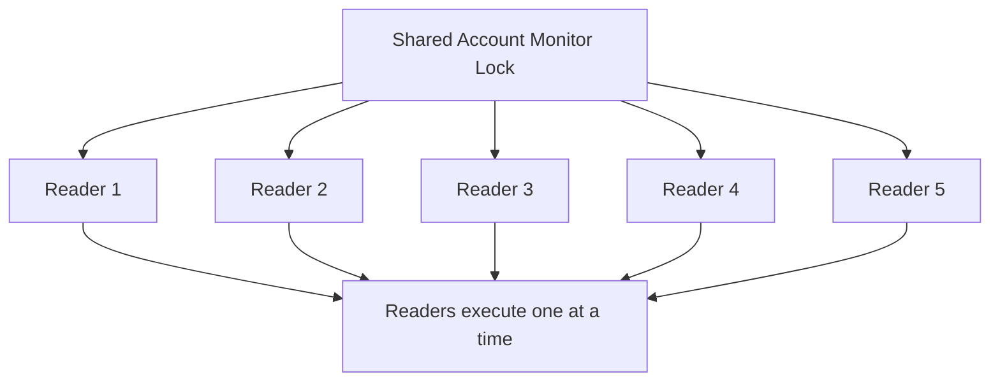
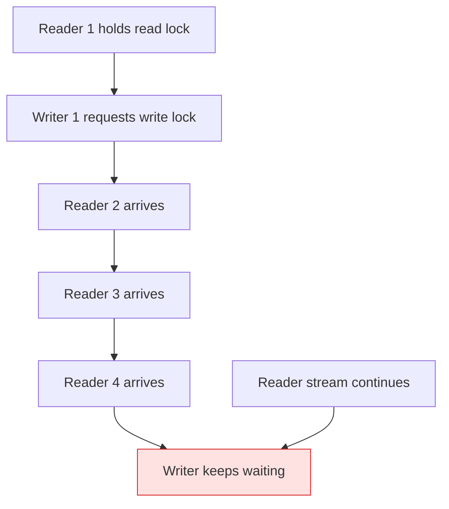

# Read Write Synchronization


Java's `synchronized` provides exclusive locking, when one thread enters a method, it acquires the object's monitor lock. 

```java
public synchronized double getBalance() {
    return balance;
}
```

Another thread attempting to enter a synchronized method or block using the same monitor must wait—even if it only wants to read.



All five operations are reads, they are serialized. It is safe, but it may unnecessarily reduce throughput when reads are frequent.

## ReadWriteLock
Java provides the `ReadWriteLock` interface, with `ReentrantReadWriteLock` being its standard implementation.

| Lock Type | Access Mode | Behavior |
|---|---|---|
| Read Lock | Shared | Multiple readers can hold it simultaneously. |
| Write Lock | Exclusive | Only one writer can hold it, with no readers allowed. |

### Compatibility Rules

| Current lock holder | New reader | New writer |
|---|---|---|
| Reader | Allowed | Wait |
| Writer | Wait | Wait |
| No lock | Allowed | Allowed |


```

flowchart TD
    A["ReadWriteLock"]
    A --> B["Reader 1"]
    A --> C["Reader 2"]
    A --> D["Reader 3"]
    A --> E["Reader 4"]
    A --> F["Reader 5"]
    B --> G["Concurrent reads"]
    C --> G
    D --> G
    E --> G
    F --> G
    style G fill:#dcfce7,stroke:#16a34a
```


The writer cannot acquire the write lock until all existing readers release their read locks. While the writer holds the write lock:

- New readers cannot enter.
- Other writers cannot enter.
- The writer can safely modify shared data.


```java
public class BankAccount {
    private double balance = 10000;
    private final ReadWriteLock rwLock = new ReentrantReadWriteLock();

    public double getBalance() {
        rwLock.readLock().lock();
        try {
            return balance;
        } finally {
            rwLock.readLock().unlock();
        }
    }

    public void deposit(double amount) {
        rwLock.writeLock().lock();
        try {
            balance += amount;
        } finally {
            rwLock.writeLock().unlock();
        }
    }
}
```


## Writer starvation



In Java `ReentrantReadWriteLock` supports two fairness policies:

### Non-fair mode (default)

```java
ReadWriteLock lock =
    new ReentrantReadWriteLock(false);
```

- Does not guarantee arrival-order fairness.
- Generally offers better throughput.
- A waiting writer may be delayed by competing readers.

### Fair mode

```java
ReadWriteLock lock =
    new ReentrantReadWriteLock(true);
```

- Generally favors the longest-waiting thread.
- Reduces the risk of indefinite starvation.
- May reduce throughput due to additional scheduling constraints.


# ReadWriteLock vs synchronized vs ReentrantLock
| Feature | synchronized | ReentrantLock | ReentrantReadWriteLock |
|---|---|---|---|
| Exclusive write access | Yes | Yes | Yes |
| Multiple concurrent readers | No, with the same monitor | No, with the same lock | Yes |
| Explicit lock/unlock | No | Yes | Yes |
| Try lock / timed acquisition | No | Yes | Yes |
| Fairness option | No | Yes | Yes |
| Reentrant | Yes | Yes | Yes |
| Complexity | Low | Medium | Higher |
