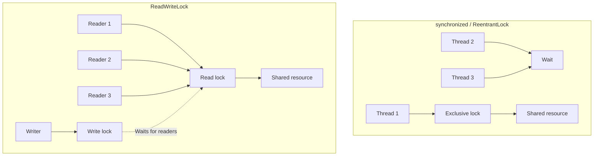

# ReadWriteLock vs synchronized vs ReentrantLock

| Feature | synchronized | ReentrantLock | ReentrantReadWriteLock |
|---|---|---|---|
| Exclusive write access | Yes | Yes | Yes |
| Multiple concurrent readers | No, with the same monitor | No, with the same lock | Yes |
| Explicit lock/unlock | No | Yes | Yes |
| Try lock / timed acquisition | No | Yes | Yes |
| Fairness option | No | Yes | Yes |
| Reentrant | Yes | Yes | Yes |
| Complexity | Low | Medium | Higher |

`ReentrantLock` is useful when you need explicit locking features such as `tryLock()`, timed acquisition, or interruptible lock acquisition.

`ReentrantReadWriteLock` is useful when reads are frequent and writes are relatively infrequent.

## Synchronized — one thread at a time
Key idea: Simple mutual exclusion. One thread at a time.

- Only one thread can hold the monitor at a time.
- Readers cannot run concurrently when they synchronize on the same monitor.
- Lock acquisition and release are automatic when entering and leaving the synchronized block/method.

## ReentrantLock — one thread at a time, with more control
It still allows only one thread to hold the lock, but gives you additional control over acquiring and releasing it.

Additional capabilities
- tryLock() — attempt to acquire without waiting indefinitely.
- tryLock(timeout) — wait for a limited time.
- lockInterruptibly() — allow a waiting thread to be interrupted.
- Optional fairness policy.
- Explicit unlock() in a finally block.

## ReadWriteLock — multiple readers, one writer
It has two locks:
- Read lock: Multiple threads can hold it simultaneously.
- Write lock: Only one thread can hold it, and no readers can hold the read lock at the same time.
