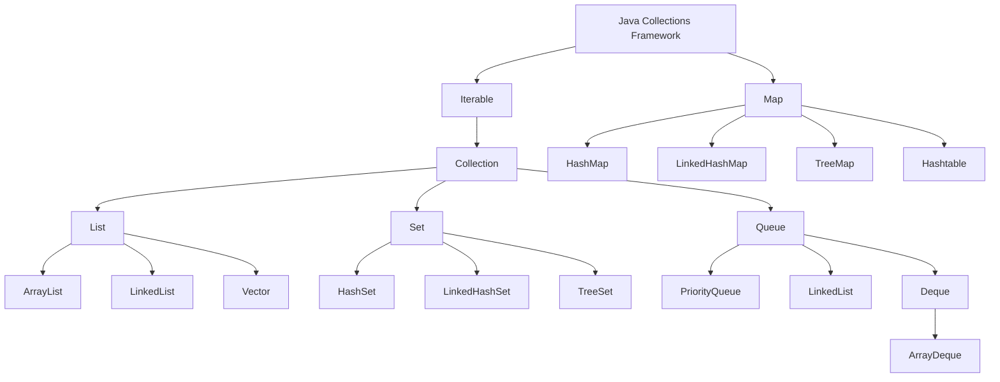
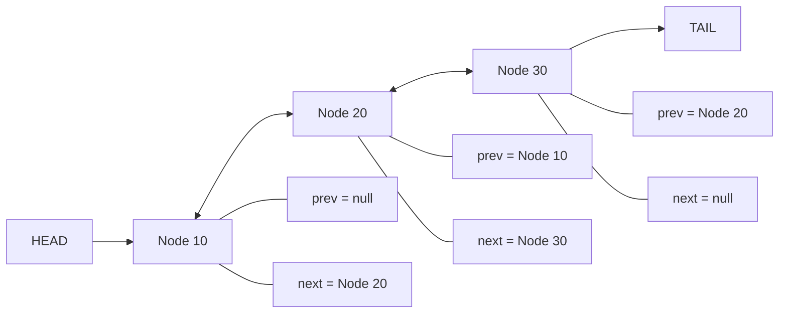

# Java Collections : A Complete Guide for DSA



| Collection      | Access                   | Search                    | Insert                              | Delete                              |
|-----------------|--------------------------|---------------------------|-------------------------------------|-------------------------------------|
| ArrayList       | Index O(1)               | O(n)                      | End: O(1) amortized; Middle: O(n)   | End: O(1); Middle: O(n)             |
| LinkedList      | Index O(n)               | O(n)                      | Ends: O(1); Known node: O(1)        | Ends: O(1); Known node: O(1)        |
| HashSet         | N/A                      | O(1) average              | O(1) average                        | O(1) average                        |
| LinkedHashSet   | N/A                      | O(1) average              | O(1) average                        | O(1) average                        |
| TreeSet         | N/A                      | O(log n)                  | O(log n)                            | O(log n)                            |
| HashMap         | Key lookup: O(1) average | Key lookup: O(1) average  | O(1) average                        | O(1) average                        |
| LinkedHashMap   | Key lookup: O(1) average | Key lookup: O(1) average  | O(1) average                        | O(1) average                        |
| TreeMap         | Key lookup: O(log n)     | Key lookup: O(log n)      | O(log n)                            | O(log n)                            |
| PriorityQueue   | Peek: O(1)               | Contains: O(n)            | O(log n)                            | Head: O(log n); Arbitrary: O(n)     |
| ArrayDeque      | Ends: O(1)               | O(n)                      | Ends: O(1) amortized                | Ends: O(1)                          |
| Vector          | Index O(1)               | O(n)                      | End: O(1) amortized                 | Middle: O(n)                        |


## List

A List stores elements in a sequence and allows duplicates.

| Operation               | ArrayList        | LinkedList |
| :---------------------- | :--------------- | :--------- |
| Get by index            | O(1)             | O(n)       |
| Add at end              | O(1) amortized   | O(1)       |
| Add/remove at beginning | O(n)             | O(1)       |
| Search by value         | O(n)             | O(n)       |


### ArrayList


!!! info "Internal" 
    ArrayList stores references in a contiguous array.

    This provides several advantages:
    - Better spatial locality when traversing the backing array.
    - Less pointer chasing than a linked list.
    - Efficient bulk copying using optimized JVM/library routines.
    - Predictable memory access patterns.
    However, remember that ArrayList<Integer> stores references to Integer objects, not primitive integers.
    
    The objects themselves may be scattered across the heap.

    ```mermaid
    flowchart TB
        subgraph AL["ArrayList"]
            A["Backing Array"]
            A --> A1["Index 0"]
            A --> A2["Index 1"]
            A --> A3["Index 2"]
            A --> A4["Index 3"]
        end
    ```    

Best for:
- Fast index-based access
- Iterating through elements
- Appending elements

ArrayList is not thread-safe but how can we make ArrayList thread-safe ?

- `Collections.synchronizedList`
- `CopyOnWriteArrayList`
  - Every mutation creates a new backing array.
- `Explicit locking`


### LinkedList
Java's LinkedList is a doubly linked list implementation of the List and Deque interfaces.



Because LinkedList is doubly linked, it can traverse from either end reduces unnecessary traversal, but it cannot provide constant-time random access.

Best for:
- Adding/removing at the ends
    - ```
      LinkedList<Integer> list = new LinkedList<>();
      list.addFirst(10);
      list.addLast(20);
      ```
- Queue or deque operations


ArrayList provides better spatial locality for its reference array. Real-world performance often favors ArrayList because of CPU cache behavior and allocation overhead.


How can we make LinkedList thread-safe?
- Synchronized wrapper
    - ```
      List<Integer> list =
          Collections.synchronizedList(new LinkedList<>());
      ```

Concurrent alternatives depending on the use case:
- Blocking FIFO queue	 => LinkedBlockingQueue
- Bounded blocking queue =>	ArrayBlockingQueue
- Non-blocking concurrent queue	=> ConcurrentLinkedQueue
- Double-ended concurrent queue	=> ConcurrentLinkedDeque


## Set
A Set stores unique values.

| Implementation  | Ordering            | Typical operation cost | Use when                                   |
| :-------------- | :------------------ | :--------------------- | :----------------------------------------- |
| HashSet         | No guaranteed order | O(1) average           | Fast membership checks                     |
| LinkedHashSet   | Insertion order     | O(1) average           | Unique values, preserve insertion order    |
| TreeSet         | Sorted order        | O(log n)               | Need sorted values or nearest-value queries|


- HashSet does not independently implement hashing, bucket management or collision resolution it internally uses HashMap.
  - Every Set element becomes a HashMap key.
- LinkedHashSet uses LinkedHashMap, which maintains a doubly linked ordering structure alongside its hash table.
- TreeSet uses a TreeMap internally, which is based on a Red-Black Tree.
  - TreeSet determines whether two elements are duplicates based on their comparison result.

Which concurrent Set should you use
- ConcurrentHashMap.newKeySet() => Concurrent hash table	High-concurrency membership checks
- CopyOnWriteArraySet => Copy-on-write array	Read-heavy, write-rare workloads
- Collections.synchronizedSet() => Synchronized wrapper	Simple synchronized access
- ConcurrentSkipListSet  => Concurrent skip list	Sorted concurrent set

## Queue and Deque
### Queue
A typical queue follows FIFO: First In, First Out.

### Deque
A double-ended queue supports adding and removing at both ends.

```java
Deque<Integer> deque = new ArrayDeque<>();

deque.offerFirst(10);
deque.offerLast(20);
```

### Stack

Use `ArrayDeque` instead of the legacy `Stack` class

```java
Deque<Integer> stack = new ArrayDeque<>();
stack.push(10);
int top = stack.pop();
```

| Data Structure | Operations             | Typical Time Complexity |
| :------------- | :--------------------- | :---------------------- |
| Stack          | push(), pop(), peek()  | O(1)                    |
| Queue          | offer(), poll(), peek()| O(1)                    |


## PriorityQueue
A PriorityQueue retrieves elements by priority rather than insertion order. It only guarantees that the head contains the highest-priority element according to its ordering.  It is based on a Binary Heap, specifically a min-heap by default. 

| Operation                 | Complexity |
| :------------------------ | :--------- |
| Insert                    | O(log n)   |
| Peek minimum/maximum      | O(1)       |
| Remove top                | O(log n)   |
| Search arbitrary element  | O(n)       |


### Min-Heap
By default, Java uses a min-heap.

```java
PriorityQueue<Integer> pq = new PriorityQueue<>();

pq.offer(30);
```

### Max-Heap

```java
PriorityQueue<Integer> maxHeap =
    new PriorityQueue<>(Collections.reverseOrder());
```


## Map
A Map stores key-value pairs.

| Implementation | Ordering                   | Typical operation cost | Use when                                  |
| :------------- | :------------------------- | :--------------------- | :---------------------------------------- |
| HashMap        | No guaranteed order        | O(1) average           | Fast lookup and frequency counting        |
| LinkedHashMap  | Insertion order by default | O(1) average           | Preserve iteration order                  |
| TreeMap        | Sorted by key              | O(log n)               | Sorted keys, floor/ceiling, range queries |


- `TreeMap` methods — `floorKey`, `ceilingKey`, `lowerKey`, `higherKey` for range and interval problems.
- `computeIfAbsent()` — convenient graph construction and grouping.
    ```
    map.computeIfAbsent(key, k -> createValue());
    ```
- `getOrDefault()` - get value or return default value.