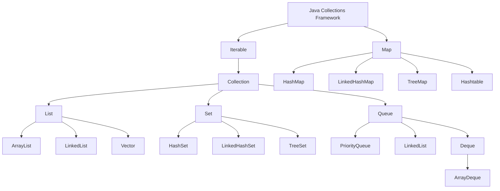

# Java Collections : A Complete Guide for DSA




| Collection      | Access / Search         | Insert                 | Delete                 |
| :-------------- | :---------------------- | :--------------------- | :--------------------- |
| ArrayList       | Index O(1), search O(n) | End O(1) amortized     | End O(1), middle O(n)  |
| LinkedList      | O(n)                    | Ends O(1)              | Ends O(1)              |
| HashSet         | O(1) average            | O(1) average           | O(1) average           |
| TreeSet         | O(log n)                | O(log n)               | O(log n)               |
| HashMap         | O(1) average            | O(1) average           | O(1) average           |
| TreeMap         | O(log n)                | O(log n)               | O(log n)               |
| PriorityQueue   | Peek O(1), search O(n)  | O(log n)               | Top O(log n)           |
| ArrayDeque      | Ends O(1)               | Ends O(1)              | Ends O(1)              |


## List

A List stores elements in a sequence and allows duplicates.

| Operation               | ArrayList        | LinkedList |
| :---------------------- | :--------------- | :--------- |
| Get by index            | O(1)             | O(n)       |
| Add at end              | O(1) amortized   | O(1)       |
| Add/remove at beginning | O(n)             | O(1)       |
| Search by value         | O(n)             | O(n)       |


### ArrayList
Best for:
- Fast index-based access
- Iterating through elements
- Appending elements

### LinkedList
A doubly linked list that also implements Deque.

Best for:
- Adding/removing at the ends
- Queue or deque operations
LinkedList<Integer> list = new LinkedList<>();

```java
list.addFirst(10);
list.addLast(20);
```

## Set
A Set stores unique values.

| Implementation  | Ordering            | Typical operation cost | Use when                                   |
| :-------------- | :------------------ | :--------------------- | :----------------------------------------- |
| HashSet         | No guaranteed order | O(1) average           | Fast membership checks                     |
| LinkedHashSet   | Insertion order     | O(1) average           | Unique values, preserve insertion order    |
| TreeSet         | Sorted order        | O(log n)               | Need sorted values or nearest-value queries|

## Queue and Deque
### Queue
A typical queue follows FIFO: First In, First Out.

### Deque
A double-ended queue supports adding and removing at both ends.

```java
Deque<Integer> deque = new ArrayDeque<>();

deque.offerFirst(10);
deque.offerLast(20);
```

### Stack

Use `ArrayDeque` instead of the legacy `Stack` class

```java
Deque<Integer> stack = new ArrayDeque<>();
stack.push(10);
int top = stack.pop();
```

| Data Structure | Operations             | Typical Time Complexity |
| :------------- | :--------------------- | :---------------------- |
| Stack          | push(), pop(), peek()  | O(1)                    |
| Queue          | offer(), poll(), peek()| O(1)                    |


## PriorityQueue
A PriorityQueue retrieves elements by priority rather than insertion order.

| Operation                 | Complexity |
| :------------------------ | :--------- |
| Insert                    | O(log n)   |
| Peek minimum/maximum      | O(1)       |
| Remove top                | O(log n)   |
| Search arbitrary element  | O(n)       |


### Min-Heap
By default, Java uses a min-heap.

```java
PriorityQueue<Integer> pq = new PriorityQueue<>();

pq.offer(30);
```

### Max-Heap

```java
PriorityQueue<Integer> maxHeap =
    new PriorityQueue<>(Collections.reverseOrder());
```


## Map
A Map stores key-value pairs.

| Implementation | Ordering                   | Typical operation cost | Use when                                  |
| :------------- | :------------------------- | :--------------------- | :---------------------------------------- |
| HashMap        | No guaranteed order        | O(1) average           | Fast lookup and frequency counting        |
| LinkedHashMap  | Insertion order by default | O(1) average           | Preserve iteration order                  |
| TreeMap        | Sorted by key              | O(log n)               | Sorted keys, floor/ceiling, range queries |


- `TreeMap` methods — `floorKey`, `ceilingKey`, `lowerKey`, `higherKey` for range and interval problems.
- `computeIfAbsent()` — convenient graph construction and grouping.
- `getOrDefault()` - get value or return default value.