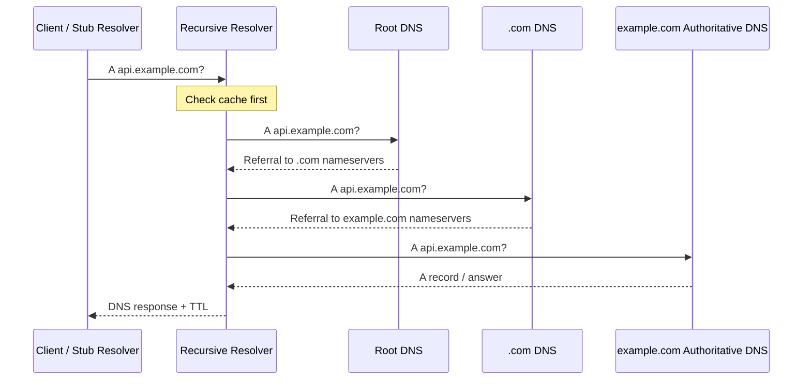

# DNS

DNS is a distributed, hierarchical naming system that translates names such as `api.example.com` into resource records containing information needed to locate or describe services.

Common usecase
- Maps names to IPv4 and IPv6 addresses.
- Directs mail delivery using MX records.
- Establishes aliases using CNAME records.
- Publishes service discovery information using SRV and other records.

DNS is an application-layer protocol, typically using UDP or TCP on port 53.


DNS names are case-insensitive for matching purposes, even though the original case may be preserved in some representations.

## Heirarchy 

- `api.example.com`
  - `com` — a top-level domain (TLD)
  - `example.com` — a domain whose zone is administered by its authoritative DNS operator.
  - `api.platform.example.com` — the fully qualified domain name ( FQDN )



- Stub resolver: the component on the client or host that submits DNS queries to a configured resolver.
- Recursive resolver: accepts a query on behalf of a client and obtains the answer, using cached data or querying other DNS servers.
- Root server: provides referrals toward the relevant TLD nameservers. It generally does not answer with the final IP for an ordinary application hostname.
- TLD nameserver: provides delegation information directing the resolver toward the authoritative nameservers for a domain.
- Authoritative nameserver: serves the records for a zone for which it is authoritative.


!!! info "Recurssive vs Iterative"
    A normal application usually makes a recursive request to its resolver. The resolver performs iterative lookups through the DNS hierarchy as needed.
    - Recursive query: the requester asks the resolver to obtain a complete answer or a definitive negative result.
    - Iterative query: the server responds with what it knows, which might be a final answer or a referral to another nameserver.

A DNS resource record is conceptually a tuple

```
NAME              TTL  CLASS  TYPE  RDATA
api.example.com.  300  IN     A     203.0.113.20
```
## DNS records: know the ones that matter

| Record | Purpose | Typical use |
| :--- | :--- | :--- |
| A | Maps a name to an IPv4 address | IPv4 service endpoints |
| AAAA | Maps a name to an IPv6 address | IPv6 service endpoints |
| CNAME | Aliases one name to another canonical name | Managed service endpoints |
| NS | Identifies authoritative nameservers | Zone delegation |
| MX | Specifies mail exchangers with priorities | Email delivery |
| PTR | Reverse name mapping from an address | Reverse DNS and diagnostics |
| SRV | Advertises a service target and port | Protocol-aware service discovery |
| HTTPS / SVCB | Advertises service connection parameters | Modern service and HTTP endpoint discovery |


### `A` and `AAAA`
These are the basic address record types. A hostname can have multiple A or AAAA records, but clients and resolvers differ in how they order, select, and use them. Returning multiple a client may choose one address, attempt another only after failure, or apply address-selection behavior of its own.

### `CNAME`
A CNAME makes one DNS name an alias of another. The resolver follows the alias to obtain the requested data for the canonical name. 

## DNS caching and TTL: the heart of DNS performance
A record's time to live (TTL) specifies how long a resolver can ordinarily reuse that cached record before it needs to refresh it.

### Positive caching vs. negative caching

There are two important categories
- **Positive caching**: the resolver caches returned records such as A, AAAA, CNAME, NS, or MX.
- **Negative caching**: the resolver caches that a requested name or record does not exist.
  - Negative caching can improve efficiency substantially, but a deployment that assumes “record added means immediately resolvable everywhere” can fail in confusing ways.
    - **NXDOMAIN**: the queried name does not exist.
    - **NOERROR** with no matching requested record (often called NODATA): the name exists, but there is no record of the requested type.

### TTL

Choose TTL values based on the operational goal, record stability, DNS provider behavior, and consequences of stale resolution.
- A short TTL can make legitimate routing changes visible sooner to cooperative resolvers, but it also increases query volume and dependency on DNS availability.
- A long TTL reduces repeated queries and can improve resolver efficiency but means old answers may persist longer during planned changes or failures.

